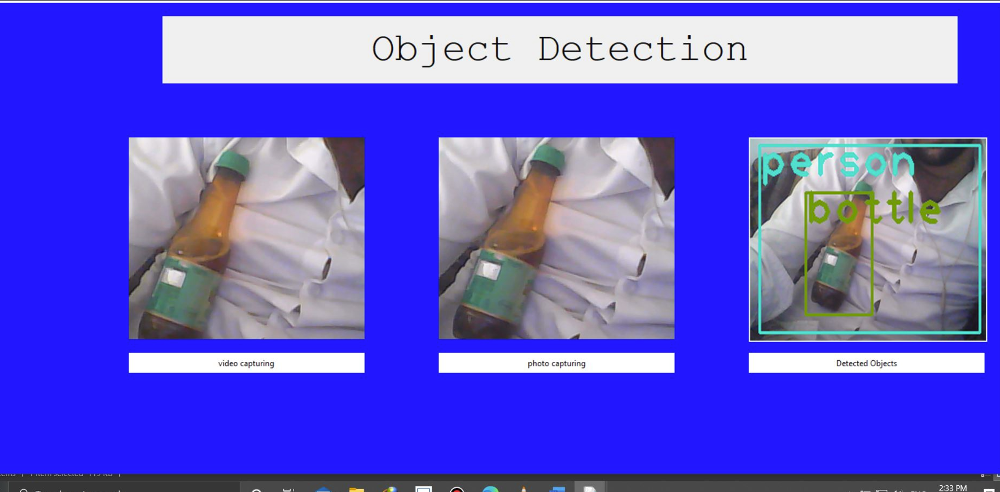

# Raspberry Pi Object Detection System

A Raspberry Pi–oriented camera application combining a Python/Tkinter graphical interface with OpenCV image capture and processing. The supplied project screenshots additionally document a YOLO-based object-detection demonstration. **The complete YOLO implementation is not yet part of this repository.**

**Author:** [Waleed Alakwa](https://github.com/WaleedAlakwa)  
**Repository:** `Raspberry-Pi-Object-Detection-System`  
**Status:** Partial source archive — Tkinter/OpenCV code available; YOLO source and model assets pending.



> **Accuracy note:** This screenshot illustrates a project demonstration, including object labels and bounding boxes. The uploaded `code.py` does **not** generate YOLO bounding boxes; it implements the camera GUI and classical image processing described below. Additional source files are needed to reproduce the detection screenshot.

## Overview

The provided project materials show an image-acquisition and analysis workflow intended for a Raspberry Pi camera setup:

- Preview images from a camera via OpenCV (`cv2.VideoCapture(0)`).
- Display a desktop interface written with Tkinter and Pillow.
- Capture a frame and save it as a PNG.
- Apply grayscale conversion, smoothing, logarithmic intensity transformation, bilateral filtering, Canny edge detection, morphological closing, and ORB feature extraction to captured imagery.
- In separate **screenshots only**, show an OpenCV DNN/YOLO workflow that creates bounding boxes and overlays object labels.

The repository **does not currently include** the YOLO script, model configuration, model weights, or class-label files. TensorFlow is not imported by the supplied source file.

## Technologies verified from the available files

| Category | Technology | Evidence |
| --- | --- | --- |
| Language | Python | `code.py` |
| User interface | Tkinter | `code.py` |
| Camera / image operations | OpenCV | `code.py` |
| Array processing | NumPy | `code.py` |
| Image conversion | Pillow | `code.py` |
| Plotting package imported | Matplotlib | `code.py` (some imports unused) |
| YOLO detection | OpenCV DNN | Partial code screenshot only; full source absent |
| Hardware environment | Raspberry Pi | Project context and Raspberry Pi filesystem paths; exact model unverified |

## Repository contents

```text
Raspberry-Pi-Object-Detection-System/
├── code.py                       # Original user-provided GUI and processing script (unchanged)
├── README.md                     # Project overview and current reproducibility status
├── LICENSE                       # MIT license; retain copyright notice
├── CITATION.cff                  # Citation metadata for GitHub
├── requirements.txt              # Dependencies imported by code.py
├── .gitignore                    # Python/cache/generated image exclusions
├── THIRD_PARTY_NOTICES.md        # Libraries and asset licensing reminders
├── docs/
│   ├── ARCHITECTURE.md           # What the available code actually does
│   ├── SETUP.md                  # Environment and preliminary launch steps
│   └── KNOWN_ISSUES.md           # Missing files and issues in the original script
└── assets/
    └── screenshots/
        ├── gui-demonstration.png
        ├── tkinter-source-preview.png
        └── yolo-source-preview.png
```

## Installation (preliminary)

You'll need Python 3, a graphical desktop, access to a connected camera, and the system Tkinter package. On Raspberry Pi OS / Debian-based systems:

```bash
sudo apt update
sudo apt install python3 python3-venv python3-tk
python3 -m venv .venv
source .venv/bin/activate
python -m pip install -r requirements.txt
```

Then attempt to start the submitted script:

```bash
python code.py
```

**This is not yet a tested end-to-end installation.** The submitted code has inconsistent hard-coded image paths, assumes camera device index `0`, and uses the removed `Image.ANTIALIAS` Pillow constant. Its capture/analyze actions need fixes before they can be considered reproducible. See [setup details](docs/SETUP.md) and [known issues](docs/KNOWN_ISSUES.md).

## Current processing pipeline (`code.py`)

```text
Camera (OpenCV VideoCapture)
        │
        ├── Live preview → Tkinter Canvas
        │
        └── Captured image → Grayscale → Blur → Log transform
                                      → Bilateral filter → Canny edges
                                      → Morphological closing → ORB keypoints
                                      → Tkinter processed-image panel
```

**Note:** Feature extraction is not equivalent to semantic object detection. The YOLO source visible in a separate screenshot is required to reproduce labeled object detection.

## Screenshots

The full GUI screenshot appears above. The screenshot-only code references can be viewed here:

- [Partial YOLO detection source screenshot](assets/screenshots/yolo-source-preview.png)
- [Partial Tkinter GUI source screenshot](assets/screenshots/tkinter-source-preview.png)

Screenshots of code are provided as project artifacts, **not** as substitutes for executable `.py` source files.

## What is still needed for a complete object-detection repository?

1. The complete `yolo_object_detection.py` source file seen in your screenshot.
2. The complete `test.py` source file seen in the other screenshot, if it is part of the same implementation.
3. Model configuration, weights, and label files, or licensed links plus exact download steps.
4. Camera details, OS/Python versions, and confirmed run commands.
5. Clarification of whether the current `code.py` is an older prototype, or a separate image-processing module.

Once these are supplied, the installation, inference instructions, dependencies, and architecture can be updated to describe the integrated solution accurately.

## Attribution and citation

**Developed by [Waleed Alakwa](https://github.com/WaleedAlakwa).** Please preserve the copyright and license notice when reusing the MIT-licensed portions. You may also cite the repository using [CITATION.cff](CITATION.cff); academic citation is encouraged but is **not a condition imposed by the MIT License**.

## License

The original code and documentation in this package are prepared for release under the [MIT License](LICENSE), **subject to the author's approval**. Third-party libraries, datasets, model weights, and separately sourced assets may have additional terms. Confirm you own or can license all contributed material before publication.

Copyright © 2026 Waleed Alakwa.
